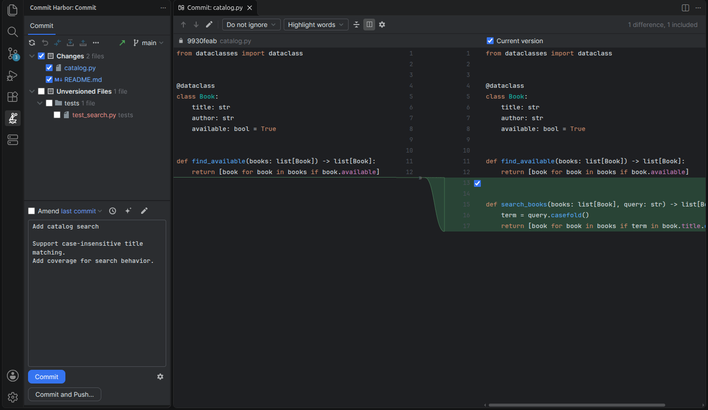
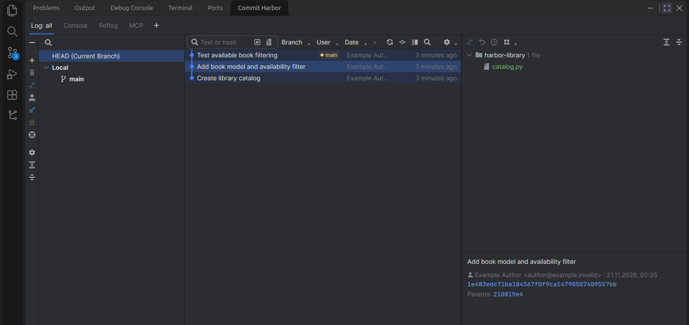
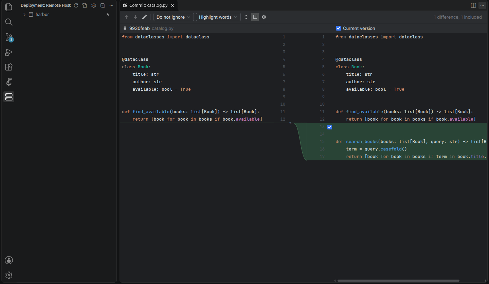
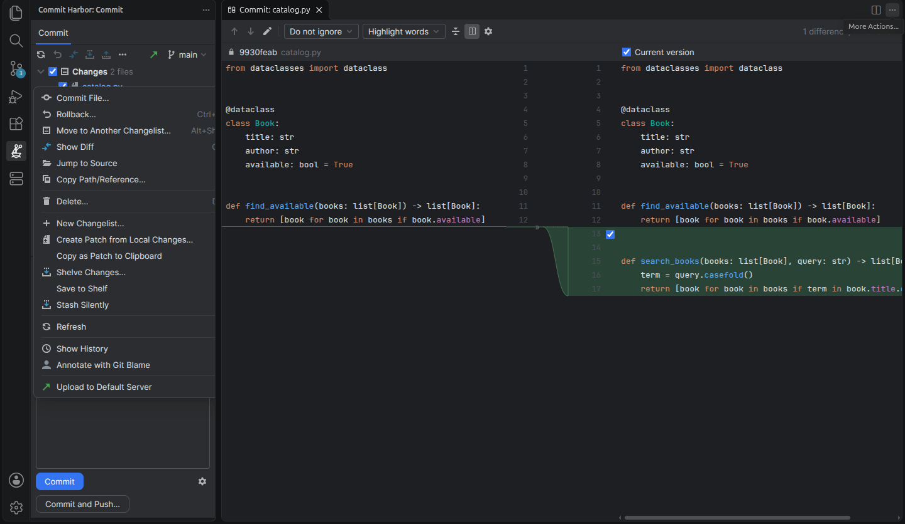

# Commit Harbor


An independent Git workbench distribution for VS Code, based on **Git Jet 0.27.4** by Santiago Bárcenas and contributors.

Commit Harbor preserves the upstream Git UI and adds downstream improvements: **the commit message pane remembers the height you choose**, the commit view remembers your checked and expanded files across window reloads, open editors are restored per Git branch, and remote deployment over SFTP, FTP, FTPS and WebDAV is built in.

## Features

Inherited from the pinned upstream distribution: the commit tool window, changelists, history graph, branch operations, shelves, push dialogs, diff/merge views and multi-repository support.

Downstream changes:

- Save and restore commit message pane height using VS Code's webview state API.
- Keep a typed commit message while the Commit view is hidden: the webview context survives switching to another sidebar view, matching the Git log and Pull Requests windows.
- Remember checked and previously seen files in the Commit view across window reloads.
- Leave newly detected modified files unchecked until you select them.
- Remember expanded and collapsed groups in the Commit view tree across window reloads.
- Commit selected files through an isolated Git index so hooks such as `pre-commit` can run without colliding with the repository index; unrelated staged changes stay staged.
- Built-in remote deployment over SFTP, FTP, FTPS and WebDAV: configure servers in `.vscode/deployment.json`, then upload, download, compare and sync from the **Remote Host** view or the **Upload to Default Server** context-menu item in the Commit pane and the file tree.
- Remember open files per Git branch. On switching branches, clean tabs for that repository are replaced with the target branch's remembered files; tabs with unsaved changes stay open. Disable `commitharbor.branches.restoreWorkspace` to turn this off.
- Keep hunk include/exclude checkmarks out of the editor gutter by default. To show them, enable **Commit Harbor › Editor: Show Hunk Inclusion Gutter** (`commitharbor.editor.showHunkInclusionGutter`) in VS Code Settings; hunk inclusion controls remain available in the Commit view either way.
- Preserve unrelated webview state and keep a usable minimum input height.
- Use a separate extension ID, `commitharbor.*` commands, views and settings.
- New extension branding and icon, with upstream attribution retained.

The original upstream feature set is inherited, not independently reimplemented. This is an early downstream release; regression tests focus on the modifications and distribution integrity, not every upstream Git operation.

## Remote deployment

Remote deployment is built in (vendored Remote Deployment 1.1.1, Apache-2.0) — no separate extension needed. Configure one or more servers in `.vscode/deployment.json` (protocol SFTP, FTP, FTPS or WebDAV, plus host, port, credentials, key or certificate, and a remote root path). The **Remote Host** view lists configured servers and project mappings and supports upload, download, compare, sync and opening remote files. In the Commit pane, right-click changed files and choose **Upload to Default Server** to send them to the default server from the current mapping. Existing `.vscode/deployment.json` files, `deploy.*` commands and `remoteDeployment.*` settings from the standalone Remote Deployment extension work as-is.

## Screenshots

Real captures from an isolated VS Code profile using a fictional **Harbor Library** repository. All example code, commits and author details were created for this demonstration.

### Commit view and diff

Review changed and unversioned files, inspect a side-by-side diff and write a commit message in a resizable pane. Commit Harbor remembers the selected message pane height when the view is recreated.



### Commit history

Browse the commit graph, inspect changed files and view the selected commit's details.



### Remote Host view

The Remote Host view lists the servers from `.vscode/deployment.json`. The starred server is the default upload target; expand a server to manage its mappings and files.



### Upload from the Commit pane

Right-click a changed file in the Commit view and choose **Upload to Default Server** to send it to the default server from the current mapping.



## Install and migrate

Install **Commit Harbor** by **Toximiner**, or install the VSIX from [GitHub Releases](https://github.com/Toximiner/commit-harbor/releases).

Disable the original **Git Jet** extension before using this distribution to avoid duplicate Git tool windows. Existing Git Jet settings do not migrate automatically: copy desired `gitjet.*` preferences to the corresponding `commitharbor.*` keys. Do not enable both MCP integrations for the same client without reviewing their configurations.

After installation, run **Developer: Reload Window**. Open the Commit Harbor commit tool window, drag the divider above the commit message, then hide and reopen the view. The selected input height is restored. Layout state is local to the webview; it is not a Settings Sync preference.

## Build and test

Requires Node.js 24 and Python 3.9 or newer:

```sh
npm ci --ignore-scripts
npm run build
npm run check
npm test
npm run package
```

The build verifies the pinned upstream VSIX checksum, extracts runtime assets, applies namespace/branding changes and readable patches in `patches/`, then creates the installable package. The build fails if the expected patch targets have changed. Generated `dist/` and `media/` directories are not committed.

## VS Code smoke test

After building, the smoke test can be run against a disposable Git repository in an isolated VS Code profile:

```sh
code --new-window --user-data-dir /tmp/commit-harbor-profile \
  --extensions-dir /tmp/commit-harbor-extensions \
  --extensionDevelopmentPath="$PWD" \
  --extensionTestsPath="$PWD/tests/vscode-smoke.cjs" \
  --disable-workspace-trust /path/to/disposable/git/repository
```

It verifies activation, isolated commands, opening/reopening the commit view and opening the log. It does not create commits or push changes. Pane-height regression tests run separately with `npm test`.

## Source availability

**This repository does not contain the original TypeScript/React sources of Git Jet.** The upstream repository returned HTTP 404 when this distribution was prepared. The vendored official VSIX contains precompiled runtime code. This repository provides the original redistributable artifact, reproducible downstream packaging, readable modifications and regression tests. It cannot regenerate the upstream bundles from their original sources.

See [UPSTREAM.md](UPSTREAM.md) for provenance and limitations. Public examples and artwork do not use private project sources.

## License and attribution

Apache License 2.0; see [LICENSE.txt](LICENSE.txt), [NOTICE](NOTICE) and [THIRD_PARTY_NOTICES.md](THIRD_PARTY_NOTICES.md).

Original Git Jet: Santiago Bárcenas and contributors. It incorporates licensed IntelliJ Community code, UI assets, fonts and third-party packages; the corresponding notices and license texts are retained.

Commit Harbor is independent and is not affiliated with or endorsed by Git Jet's original author or JetBrains. JetBrains, IntelliJ IDEA, WebStorm and PyCharm are trademarks of JetBrains s.r.o.; references describe the upstream workflow only.
